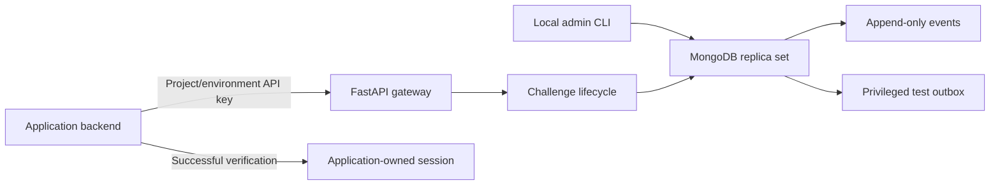

# OTPigeon technical documentation

## Architecture



The CLI connects directly to MongoDB; it exposes no HTTP administration API.
The gateway uses PyMongo's native async driver. A replica set is required because
challenge state, budgets, events, and idempotency records commit together.
Startup refuses a standalone MongoDB server or a missing/placeholder secret.

The legacy Node WhatsApp sender is not part of the default graph or Compose.

## Storage and isolation

- `projects`: display name and provider configuration for `test` and `live`.
  Test uses `mock`; live is unconfigured and disabled in this milestone.
- `api_keys`: random high-entropy keys stored as SHA-256 digests, environment,
  project, issue time, and revocation time. The raw key is shown only on issuance.
- `challenges`: immutable ID, project/environment/destination/purpose scope,
  HMAC code hash, generation, lifecycle, delivery outcome, expiry, and limits.
- `gates`: one revision/event sequence per project/environment. Each operation
  writes the gate first in a snapshot/majority transaction. Conflicting workers
  retry against fresh state. This prevents write skew in scopes and budgets.
- `budgets`: rolling send timestamps per project/environment and destination;
  failed verification timestamps per destination. New challenges do not reset them.
- `events`: append-only masked lifecycle and delivery records, with a monotonic
  sequence per project/environment for pagination.
- `idempotency`: operation/resource-scoped response snapshots retained for at
  least 24 hours. Only expired snapshots have a TTL index.
- `outbox`: plaintext simulated codes accessible only to their owner's test key.
  Entries disappear on terminal transitions and expire through a TTL index.

All challenge lookups include project/environment ownership. API keys never
authorize legacy operator endpoints. There are no API endpoints for issuing keys,
mutating projects, editing events, or reading provider credentials.

Transaction callbacks may be retried. Mock preparation is pure and the outbox
write is transactional. **Do not put a real provider network send in this
callback.** Later adapters need durable dispatch, provider idempotency, and an
explicit ambiguous-outcome reconciliation design.

## Challenge lifecycle

Statuses: `pending`, `verified`, `expired`, `locked`, `superseded`.

There is at most one pending challenge per project/environment/destination/purpose.
Create during cooldown returns 429. Create after cooldown supersedes an existing
pending challenge if the send budget allows it. Each terminal transition emits
exactly one event and cannot be undone by expiry or late delivery results.

Default rules:

| Setting | Default |
| --- | --- |
| Expiry | 300 seconds |
| Create/resend cooldown | 60 seconds |
| Wrong attempts per challenge | 5 |
| Resends per challenge | 3 |
| Sends per destination/environment/project | 5 per rolling hour |
| Failed verifies per destination/environment/project | 10 per rolling hour |
| Sends per project/environment | 1,000 per rolling hour |

Resend rotates the generation/code, invalidates the previous code, preserves
attempts, and does not extend the original expiry. A different purpose has its
own challenge, while destination budgets remain shared. The fifth wrong attempt
locks the challenge. A spent destination guess budget blocks comparison even
when the next submitted code is correct.

Concurrent correct verifies produce exactly one `verified: true`; later calls
return `verified: false` with `reason: already_verified`. Your backend must bind
that one successful result to its pending user and flow before creating a session.
OTPigeon does not issue application sessions or identify users.

All timestamps use UTC with BSON's millisecond precision. Reads enforce expiry;
challenge records and events are not TTL-deleted. There is no background expiry
sweeper: an untouched pending record transitions when accessed. Automatic history
retention is deferred, so operators must account for storage growth.

## Delivery meaning

Delivery is separate from verification. Its status is `not_attempted`,
`provider_accepted`, `provider_failed`, or `unknown`. Every M1 result explicitly
says `provider: mock`, `environment: test`, and `simulated: true`.

No endpoint reports `delivered`. Accepted means the simulated provider accepted
an attempt, not that a real device received it. A known failure has a bounded
reason; an ambiguous outcome is `unknown` and leaves the challenge verifiable
until expiry. A resend is possible after cooldown and within budgets.

Fault providers are test-only injections, not configurable runtime modes. The
internal receipt boundary checks the generation and updates delivery separately
from verification. It has no HTTP endpoint in M1; real provider webhooks and
signature verification remain later work.

## API contracts

Authorization: `Authorization: Bearer otpg_test_…` or `otpg_live_…`.
Create/resend require `Idempotency-Key`: 1–128 ASCII letters, digits, `.`, `_`,
`:`, or `-`. Use a new key for a new logical operation, and retain it for retries.
It is scoped to project/environment/operation/resource, including resend's ID.
The same key/body replays its original HTTP status and response; a changed body
returns 409. Replays are snapshots: use GET for current state after verification.
Rate-limit responses are also replayed, so use a new operation key after waiting.

Create body:

```json
{"destination":"+12025550123","purpose":"login"}
```

Destination must be E.164-shaped ASCII digits; purpose is a lowercase slug up to
64 characters. Unexpected fields are rejected. Resend takes `{}`. Verify takes
exactly a six-digit ASCII string, preserving leading zeroes:

```json
{"code":"012345"}
```

Challenge responses include `challenge_id`, `project_id`, `environment`,
`destination`, `purpose`, `status`, `delivery`, `expires_at`,
`resend_available_at`, and `attempts_remaining`. Verify additionally includes
`verified` and `reason`.

Events use `items` and `next_cursor`. Pass that cursor as `after` for the next
page, and `limit` from 1 to 100. `/v1/events` accepts `challenge_id` and `type`.
Destinations are masked in events; no codes or API keys are recorded in them.
Challenge responses reveal the full destination only to its owning key.

Errors have `{"error":{"code":"…","message":"…"}}`. Rate limiting returns
429 with `error.retry_after` and a `Retry-After` header. Missing/revoked keys
return 401, foreign or unknown challenges return 404, and live delivery returns
503. Adapter/database internals are not returned.

## Configuration and operation

`OTPIGEON_SECRET` is a required generated secret of at least 32 characters. Keep
it separate from API keys and legacy admin tokens. Changing it invalidates pending
codes; all API workers must use the same secret and limit configuration.

For a native API process, configure `MONGODB_URL` and `MONGODB_DB_NAME` and use
`backend/.env.example` as a reference. Limit environment names are:
`OTPIGEON_EXPIRY_SECONDS`, `OTPIGEON_COOLDOWN_SECONDS`, `OTPIGEON_MAX_ATTEMPTS`,
`OTPIGEON_MAX_RESENDS`, `OTPIGEON_DESTINATION_SENDS_PER_HOUR`,
`OTPIGEON_DESTINATION_GUESSES_PER_HOUR`, and `OTPIGEON_PROJECT_SENDS_PER_HOUR`.
Compose uses the documented defaults; customize its `environment` map to override
limits. Test configuration is injected through the application factory.

`./scripts/dev.sh` initializes an exclusive `.env` and starts Compose. Restarting
reuses only that Compose project's volume. `docker compose down` stops services
without deleting the volume. Never remove volumes/databases you did not create.
The initializer refuses to overwrite existing files and sets mode 0600.

`python -m app.admin` supports `create-project`, `issue-key`, `list-keys`, and
`revoke-key`. Run it from the backend directory or through `docker compose exec`.
Only issuance prints a raw key; protect its terminal output. No default API keys
are installed. A generated Compose project name gives each checkout its own data.

## Legacy PoC quarantine

The previous FastAPI routes are preserved in `app/legacy.py`. They are not mounted
by default and Compose always sets `OTPIGEON_ENABLE_LEGACY=false`. To deliberately
operate the PoC outside Compose, set `OTPIGEON_ENABLE_LEGACY=true` and a distinct
`OTPIGEON_LEGACY_ADMIN_TOKEN` of at least 32 characters. Every legacy route requires
that token as Bearer authorization. Project keys cannot access it.

The Node sender separately requires a generated `SENDER_API_KEY` of at least
32 characters, has no public fallback, binds `127.0.0.1` by default, and protects
`/status`. Set `HOST` explicitly only for a deliberately configured network.
The backend's `WHATSAPP_SENDER_API_KEY` must match it. Neither service starts or
links a WhatsApp sender automatically in this milestone.

Legacy code keeps its original global-phone OTP model, races, timeout behavior,
and console mock output. Those are quarantined rather than upgraded. It is not a
production path. Existing MongoDB state and `.wwebjs_auth` sessions are preserved;
the new gateway uses separate collections/database by default and does not migrate
or delete old records. The unofficial Node dependency tree also has known npm
audit findings; dependency upgrades and live operation were excluded from M1.

## Validation and roadmap

See [the milestone verification record](docs/verification/m1.md) for reproduced
failures, replay evidence, and checks actually run. Tests use a real disposable
replica set for isolation, concurrent workers, idempotency, budgets, and expiry.

Later milestones: operator dashboard, server SDK, official WhatsApp and one SMS
adapter, receipts/webhooks, retention, and production abuse controls. No real
message delivery or production readiness is claimed by this milestone.
